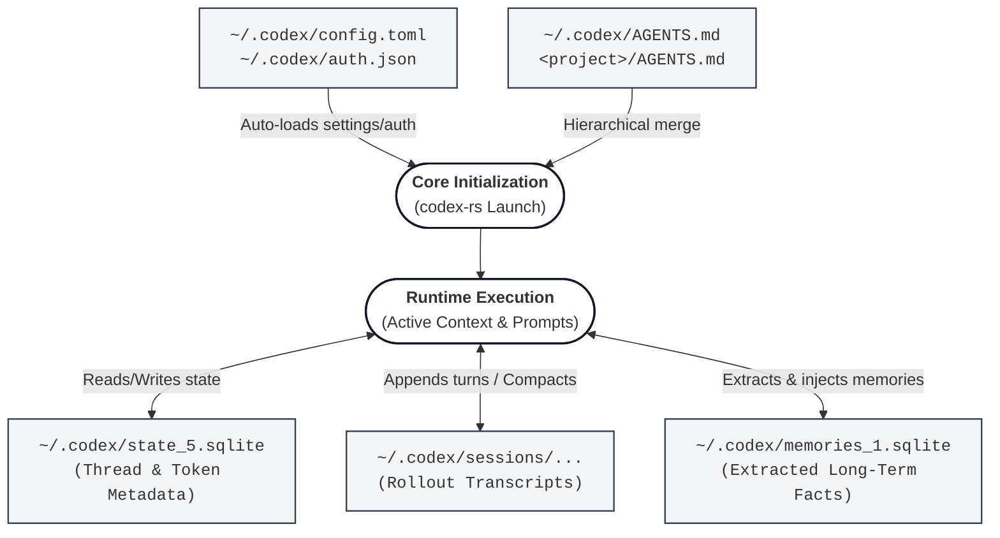

# OpenAI Codex CLI: Storage & Data Flow

## Deliverables
- **[`Source-detail.pdf`](Source-detail.pdf)**: Storage persistence table and 1-page architecture diagram.

## Storage Persistence Map

| Store | What it Stores | Written By | Auto-Loaded? | How Deleted |
| :--- | :--- | :--- | :--- | :--- |
| `~/.codex/config.toml` | User configuration, sandbox policy, and feature flags. | User / Harness | YES | Manual file deletion. |
| `~/.codex/auth.json` | API keys, OAuth tokens, and account identity. | Harness | YES | `codex logout` or manual deletion. |
| `~/.codex/state_5.sqlite` | Active threads, git metadata, and token counts. | Harness | YES | `codex delete` or database reset. |
| `~/.codex/sessions/...` | Full append-only conversation transcript and tool outputs. | Harness | NO (Yes on resume) | `codex delete` or manual purge. |
| `~/.codex/memories_1.sqlite` | Extracted long-term agent memories and facts. | Harness | YES | Thread or row deletion. |
| `~/.codex/AGENTS.md` | Global user instructions and behavior guidelines. | User | YES | Manual file deletion. |
| `<project>/AGENTS.md` | Project-specific rules and build instructions. | Developer | YES | Manual deletion or `git rm`. |

## Architecture & Data Flow Diagram



## Source Code Findings
- **File Writes (`~/.codex`)**: Grepped `codex-rs` to map all persistent stores, identifying whether each is written mechanically by the harness or by the user, auto-loaded on startup, and how it is deleted.
- **Compaction Prompt**: Located `SUMMARIZATION_PROMPT` and `SUMMARY_PREFIX` in the source code. When context limits are reached, the harness prompts the model to summarize prior messages and replaces older turns with the compacted summary.
- **AGENTS.md Merging**: Inspected `codex-rs/core/src/agents_md.rs`. The harness discovers global instructions (`~/.codex/AGENTS.md`) and project-level instructions (`<project>/AGENTS.md`), merging them hierarchically into the initial context.

## PowerShell Verification & Source Inspection

```powershell
# 1. Search source code for ~/.codex paths and persistence stores
Select-String -Path "codex-rs\**\*.rs" -Pattern "\.codex|config\.toml|auth\.json|sqlite|AGENTS\.md"

# 2. Locate the conversation compaction prompt
Select-String -Path "codex-rs\**\*.rs" -Pattern "SUMMARIZATION_PROMPT|SUMMARY_PREFIX"

# 3. Inspect AGENTS.md discovery and hierarchical merging
Get-Content "codex-rs\core\src\agents_md.rs"

# 4. Verify local runtime directory structure (API key masked in .env)
# GEMINI_API_KEY="........."
codex exec "list the files in this repo"
Get-ChildItem -Path "$HOME\.codex" -Force
```
